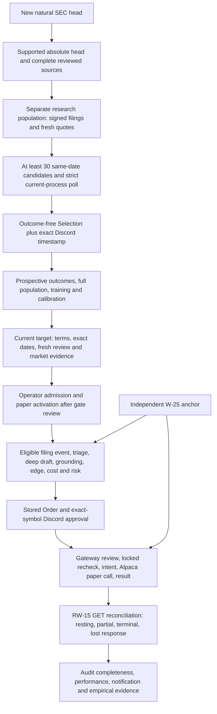

# Selection → RW-15: operator runbook, gates and blockers

**Disposition: keep `c5ef0ad` awareness-only. A date-ready natural head is a research trigger, not permission to select a cohort, seed a watchlist, enter paper mode, or create an Order. The source contains additional handoff and lost-response gaps that must be reviewed before this path can be called end-to-end ready.**

For Admin: record the next natural head and the separate readiness counts. If the full prospective population is absent, stop at research evidence. Before selection, resolve the cohort collection and independent-quality prerequisites. Before paper activation, resolve the target-provisioning, broker-contract and ambiguous-submit safety findings below as well as W-25. No action in that sequence is executed by this document.

This is the requested September 6 Pacific-time research record. The deadline of September 6, 2026, 20:15 America/Los_Angeles is September 7, 03:15 UTC. Research began at 00:45:15 UTC. No production composition, model job, credential lookup, SEC intake, database operation, watchlist change, Discord interaction, broker request, order creation, soak restart, repin, or incident-ledger repair was performed. Public vendor documentation was read; local validation used source inspection and functions with no side effects. No commit or PR was created.

## Evidence boundary and current hold

| Item | Evidence and limit |
|---|---|
| Inspected checkout | Initially clean `892e2dbaab0093e91857cea373dc188d638d8d80`, a documentation commit after merged PR #70. Both `app/` and `tools/` are identical to `c5ef0ad`. Their Git tree IDs are `5125e7edd2489c027364bbbfbd4556d928109817` and `dce8f9434252fabffc4e4dd49f4100e5be277019`, respectively. |
| Soak | The operator's pin is `c5ef0ad3d9acd3a85aa86228491ea1827bfd529e`, awareness-only. This task did not inspect or change its process, configuration, ledger or checkout. A matching source tree is not serving-process attestation. |
| Empty merger watchlist today | Required by the operator. The [earlier September 6 smoke record](astra-fresh-install-smokes-2026-09-06.md) also observed empty disk settings. It could not attest authenticated runtime health or process identity. This report does not turn that disk observation into a new runtime measurement. |
| Last committed natural-head screen | [September 4](w24-natural-head-rescreen-2026-09-04.md): 192 discovery names, 30 supported absolute heads, **0 selection-ready, 0 date-ready**, no commitment or witness post. It used the earlier #62 parser; it is not a fresh screen of September 6 filings under PR #70. |
| Application acceptance | [September 6 DEC-09 evidence](rw20-matrix-isolation-2026-09-06.md) covers the identical application subtree. This session ran no application suite or Windows/WSL matrix. Local Python is 3.13.5, a diagnostic environment. |
| Authority evidence | No qualifying prospective cohort/current-target activation or real RW-15 broker lifecycle is established by the cited records. Independent W-25 authority remains an open prerequisite; see the [witness plan](rw20-independent-witness-plan-2026-09-06.md). |

Follow [CLAUDE.md](../../CLAUDE.md), [PLAN](../PLAN.md), [REGISTER](../REGISTER.md), and the W-23/W-24/W-22 runbooks. Older text saying W-23 is unimplemented, #70 is still unmerged, the soak is `61ca0af`, or hosted/macOS jobs are mandatory is historical. DEC-09 requires the operator's native Windows and Ubuntu/WSL2 × Python 3.11/3.12 matrix. None of those documentation corrections closes empirical gates.

Monday September 7 is the NYSE Labor Day holiday; the next scheduled regular session is Tuesday September 8. A holiday GET-only discovery wake is not a paper market day. This task changed no wake or schedule. [NYSE calendar](https://www.nyse.com/trade/hours-calendars).

## Readiness means several different things

| Term | What it establishes | What remains |
|---|---|---|
| Discovery hit | A name worth screening | Absolute head, identity, complete sources, eligibility, dates, signatures and every authority gate |
| Supported head | Absolute current SEC head is in `{8-K, 10-Q, 10-K}` | Merger semantics; 30 supported heads are not 30 eligible deals |
| Screen selection-ready | Source-set eligibility plus current-head/end-of-source-set agreement | Signed production provenance, fresh quotes/polls, population review and commitment |
| Date-ready current target | Both unique expected-resolution and outside dates parse from affirmative source language | Expected resolution must still fall within the provider's current 30-day horizon; all other gates remain |
| Recorded selection | Signed outcome-free manifest with exact Discord chronology receipt | Calibration maturity, independent parser-quality evidence, current deal and execution authority |
| Recorded calibration/deal | Immutable record passes its recorder's checks | Full W-24 semantic verification occurs downstream; a `recorded ...` CLI message is not an edge PASS |
| Edge source available | Current source/deal/calibration/market evidence verifies | An actual proposal's quantity, gross-edge/cost rule, risk, mode, human approval and gateway checks |
| Order submitted | The gateway recorded a broker response and local submit | Resting/partial/terminal reconciliation, notifications and audit completeness |
| RW-15 evidence complete | Real broker observations establish the named lifecycle cases without unresolved gaps | W-22's two qualifying unattended days and all later release gates |

The manifest requires at least **30 distinct same-date evaluation identities**. Current-target exact dates are a separate later gate; it does not require 30 simultaneous date-ready orders. Conversely, one date-ready name cannot replace the cohort. The current executable target need not be one of the calibration names, and an early target can cease to be date-ready while the cohort matures. Re-screen at activation time. [Manifest contract][manifest], [current provider][provider].

One implementation qualification matters: selection verifies that predictions equal source-derived fields, but the explicit `_require_strategy_eligible` rejection is applied during calibration semantic verification. Admin should screen out ineligible source-derived predictions **before** committing; otherwise a witnessed population can be unusable later and cannot be silently trimmed. [Selection checks][selection-checks], [semantic calibration][semantic-calibration].



The arrows show the intended dependency path. The gap list below identifies where the current composition or operator tooling cannot yet carry it through. Filing discovery and model prose have no arrow directly to an approval or broker submission.

## Operator sequence and stop rules

All mutation examples below are **future operator entrypoints**, not commands executed or authorized by this research task. `read_only` is the application's mode: a provisioning command can still write research rows, raw files and audit events, and `selection` posts to Discord. Do not mistake it for a GET-only diagnostic.

### 0. Establish the epoch and observation record

Admin must bind the serving PID, startup SHA, interpreter, working directory, DB/raw/audit-head paths and loaded settings to the approved epoch. Keep the `c5ef0ad` soak unchanged and keep the frozen BUG-114 incident evidence separate. A later activation or repair requires its own reviewed source/epoch; this document supplies no cutover instruction.

From the actual operator host, obtain authenticated `GET /status`, `GET /mode` and `GET /quant/status`, without exposing the API key. Require the expected read-only mode, a valid audit chain, understood watch-only reasons, current feed health, and the empty merger watchlist. `/status` alone does not expose the serving SHA, execution watchlists or a complete RW-15 report. A healthy HTTP response is insufficient. [Status implementation][status], [composition][compose].

**Stop:** source/epoch uncertainty, bad chain, unknown data health or missing host observations. Preserve evidence; do not repair a ledger or restart until it looks green.

### 1. Screen the new head without granting authority

Record the screen time, parser SHA, ticker-to-CIK source, absolute head accession/form/date, exact primary-document URLs and content hashes. Build the complete ordered supported source set from the original semantic source through the current accession. Keep counts for supported heads, selection-ready names and date-ready targets separately.

Use affirmative source-derived cash/common-equity/definitive-agreement facts and preserve exclusions. Year-only forecasts, conditional failure dates and unresolved automatic extensions do not become exact dates. Do not substitute an older supported filing for an unsupported absolute head, an exhibit for the required primary source, or a model inference for a refused parser field. Existing rescreens are discovery evidence, not signed production intake. [September 4 method](w24-natural-head-rescreen-2026-09-04.md), [RW-21 evidence](rw21-repair-notes-2026-09-06.md).

**Stop:** unsupported head, incomplete set, no semantic eligibility, ambiguous dates for the current-target claim, or fewer than 30 same-date eligible research candidates. A single successful name can be recorded as research progress only.

### 2. Prepare research evidence without expanding execution eligibility

Before a selection session, establish an authorized research collection path for every cohort CIK and its entry quote, plus subsequent outcome filings, price observations and poll coverage. This is a present tooling gap: the composed market-data universe is the configured watchlist plus actual holdings; the general watchlist has a **25-symbol maximum**, while selection needs **30 unique symbols/CIKs**. The selection CLI polls explicit CIKs but does not collect their quotes or schedule their future monitoring. Do not enlarge or rotate execution eligibility to solve this. [Universe composition][paper-compose], [watchlist cap][watchlist-cap], [selection poll][selection-poll].

Normal first-contact EDGAR polling establishes a baseline and intentionally skips historical filings. The supported exact-accession importer signs historical SEC provenance; copying previously downloaded bytes or bare-inserting a `Filing` does not. For an authorized intake, invoke once for the original source, each intervening supported filing and the current source:

```text
<project-venv-python> tools/provision_merger_edge.py --db-url <approved-db-url> --raw-root <approved-raw-root> filing --cik <real-10-digit-cik> --accession <real-accession>
```

Use `.venv/bin/python` on Linux or `.venv\Scripts\python.exe` on Windows, from the repository root. Pin the intended non-secret config and existing credential/audit store; placeholders are not executable examples. The importer searches bounded SEC history, checks the supported form and primary document, preserves honest import time, and atomically binds the domain row to `filing_ingested` and raw hashes. It does **not** itself establish a fresh EDGAR completion or create a proposal event. Current-deal authority also needs signed symbol/CIK attribution. [Importer][filing-import], [deal provenance][deal-provenance].

**Stop:** no reviewed cohort-only collection path, missing attribution/baseline, unsigned raw/domain bindings, insufficient source coverage, unavailable SEC User-Agent configuration or exceeded fetch budgets.

### 3. Commit the prospective Selection only when the full population is ready

Prepare the exact outcome-free schema from the [W-24 runbook](../runbooks/w24-merger-semantic-verifier.md). Each candidate supplies `deal_id`, `symbol`, `target_cik`, `source_accession`, ordered `source_accessions`, `current_accession`, `selected_at`, `entry_ask`, `eligibility_prediction`, `eligibility_source`, and `entry_price_source`. Do not add outcomes or authority fields; the recorder derives authority fields itself.

The actual gates are:

1. At least 30 candidates; unique deal IDs, symbols, CIKs, original accessions and current accessions. All `selected_at` values equal the commitment's **UTC date**; training cutoff strictly precedes it.
2. Each source list starts with the original source, ends with the current accession, has no duplicates, contains at most 250 accessions, and includes every signed filing in the inclusive source/current filing-date interval. Chronology, raw hashes, signed rows and pre-commit timestamps agree.
3. Predictions match source-set derivation. Review strategy exclusions before posting because eventual calibration rejects ineligible members.
4. A signed raw entry ask for the same symbol and selection date predates commitment and is no more than five minutes old by exchange time. Its audit time cannot precede exchange time or follow commitment.
5. The CLI runs a strict final EDGAR poll for **every candidate CIK**, requiring full successful coverage in its own process. The current accession must equal the audited baseline; the poll must cover the signed filing head and be no older than ten minutes.
6. The canonical manifest hash is posted as `merger-selection-commitment <sha256>`. The receipt must bind exact bytes, message ID, configured channel and authenticated bot author, with no edit/webhook. The code permits **±5 minutes** between local commitment time and Discord server time, not just a forward five-minute deadline.
7. Source/authority checks run again after the external call in the persistence transaction. The `MergerSelectionCommitment` ID is `msel_<hash>` and its event is `merger_selection_commitment`.

```text
<project-venv-python> tools/provision_merger_edge.py --db-url <approved-db-url> --raw-root <approved-raw-root> selection --candidates <reviewed-outcome-free-json> --training-cutoff <real-training-cutoff>
```

Retain the candidate file and hash, complete manifest/hash, source and quote references, poll sequences/process epoch, signed commitment sequence, Discord message ID and server timestamp. The CLI prints row ID/content hash/audit head; obtain the **witness message ID from the persisted commitment and signed event**, not from an assumed extra CLI output. If the post succeeds but local persistence fails, preserve that orphan post as failed-attempt evidence; it alone grants no authority. Never edit/delete/relabel it into a successful commitment. [CLI][cli], [recorder][selection], [Discord binding][semantic-witness].

### 4. Observe the real horizon and freeze calibration

Keep all committed evaluation IDs exactly once, with no additions or exclusions. At least 10 training rows precede the evaluation selection date, and at least 30 evaluation rows remain. The raw evaluation population must contain **closed, failed and open** outcomes. A cohort with only successful closures cannot be made qualifying by inventing a failure or open mark.

For each row, retain source-derived eligibility, a distinct later SEC outcome filing, a signed outcome-price observation and the full outcome filing universe. `closed`/`failed` outcomes must occur strictly after selection and by day 30. An `open` row is valid only at **exactly day 30**, with source language establishing that it remains pending; silence is insufficient. Evaluation outcome detection and audit times must follow the Discord witness.

Require a successful signed per-CIK poll at or after 00:00 UTC on the day following `outcome_as_of`; its audit record must follow completion within five minutes and its filing head must cover the latest signed filing/outcome. Re-check conflicts and unsigned/hidden domain rows. Because an open evaluation outcome is mandatory, the qualifying population cannot mature on selection day. [Statistics][cohort], [semantic outcomes][semantic-calibration].

The v2 calibration references the exact `selection_manifest_id`. The CLI overwrites derived statistics and raw-cohort identity; it derives the Wilson 95% lower completion estimate, empirical failure/open allocation and worst observed failure/open price ratios. These are the pinned model inputs, not a guarantee of investment return. Preserve independent held-out field review (≥95%, with no false-positive eligibility/outcome acceptance) separately: same-parser prediction/label agreement is not independent measurement.

```text
<project-venv-python> tools/provision_merger_edge.py --db-url <approved-db-url> --raw-root <approved-raw-root> calibration --document <reviewed-v2-metadata> --cohort <complete-raw-cohort> --day <snapshot-date> --key <new-write-once-key>
```

**Stop:** immature horizon, missing outcome class, dropped member, stale/incomplete post-outcome poll, inadequate independent labels or any source mismatch. Recording calibration checks W-23 statistics/provenance; it does not invoke full W-24 semantic verification. A recorded row can still be unusable downstream. [Calibration recorder][calibration-record], [quality protocol](../research/gate-feasibility-and-value-2026-09-06.md).

### 5. Review the current target — blocked CLI handoff at this pin

The current target needs immutable `merger_deal.v1` evidence: signed attribution and complete sources, active definitive cash-only common equity, source-derived exclusions/conditions, both exact dates, and a review no older than 24 hours. `outside_date >= expected_resolution_date`; expected resolution must be between the evaluation clock's current date and +30 calendar days. Re-review after every new target filing or changed term. Do not keep an earlier active record by deleting a later adverse record. [Deal normalization][deal-normalization], [provider][provider].

The documented operator entrypoint is:

```text
<project-venv-python> tools/provision_merger_edge.py --db-url <approved-db-url> --raw-root <approved-raw-root> deal --document <reviewed-current-deal-json>
```

**Do not treat that command as a working continuation on `c5ef0ad`.** Each CLI invocation builds a new `OrchestratorState.process_epoch`. The `deal` branch calls `record_deal_evidence` without running an EDGAR poll; the recorder requires a completion with that exact new epoch. A service poll, a prior `filing` invocation, or the earlier `selection` process cannot satisfy it. A separately reviewed repair must compose the strict poll and deal recording in the same authorized process, preserving final rechecks. Do not copy an epoch, inject a completion, or weaken the epoch comparison. [CLI][cli], [epoch][epoch], [freshness][edgar-binding], [deal recorder][deal-record].

There is a second blocker for an ordinary later head: `CashMergerEdgeProvider._verify_deal` still rejects `current_accession != announcement_accession` when `amendment_reviewed` is false. RW-21's semantic verifier correctly derives false for an ordinary later filing. Setting it true instead fails source-derived semantic comparison. The semantic-only regression does not exercise this provider path. Preserve both source files and fix the composed contradiction in a separate package; do not claim BUG-122's semantic test proves provider availability. [Provider][provider], [semantic verifier][semantic-deal], [existing regression][ordinary-regression].

### 6. Clear independent-witness, market and operator admission gates

W-24's exact Discord receipt proves chronology. With Administrator retained, it is **not** W-25/SEC-11 immutable audit-head authority. Production always composes an anchor-store object; with mirrors only, `latest()` supplies no trusted anchor. The scheduled `DeepBudget` refuses before a deep draft, and the gateway's pending-exposure check also refuses. Thus absent W-25 is an actual paper-path blocker, even if `/mode` can display `paper`. Merger recorders can still verify the local chain when there is no latest anchor, so research-record success does not prove this downstream gate passed. [Anchor composition][anchor-compose], [deep budget][deep-budget], [pending gate][pending].

Use the existing [independent-witness plan](rw20-independent-witness-plan-2026-09-06.md) and [W-25 runbook](../runbooks/w25-worm-audit-witness.md) for separately authorized provider/cost selection, real retention/rollback evidence and activation. Do not substitute Discord, local Git, same-host storage or an unreviewed provider.

Only after the evidence and applicable repairs pass may Admin separately review admission to the startup-frozen general and merger lists. The ≤25 cap remains; research selection does not change either list. Keep the awareness-only `c5ef0ad` epoch unchanged during this task. Any later reviewed activation must also allow the **serving process** to acquire its own successful EDGAR completion; an importer process's watermark is insufficient.

Before an order candidate, require current-process EDGAR evidence ≤10 minutes old; exact signed quote/raw binding on an allowed feed, age ≤120 seconds by default; ask ≥$5 and spread ≤50 bps; signed bars producing ≥20 observations, median daily dollar volume ≥$20 million, positive volatility and metrics ≤7 days old. Calibration must not be future-dated or older than 365 days; the quote must follow the reviewed deal timestamp. These are strategy limits, not substitutes for stricter current risk settings. [Market verification][market-verification].

Inspect `GET /quant/status.verification.expected_edge_source` (Discord equivalent: `/quant action:status`). `unavailable` is a refusal. `available` validates source readiness but does not price an actual proposal or certify the net-edge threshold. Read `last_evaluation` and the eventual execution verdict. [Provider status][provider-status].

### 7. Enter paper mode through the actual operator surface

Future activation uses the authenticated loopback **`PUT /mode`**, with reviewed body fields `mode: "paper"`, `actor`, and `reason`, followed by `GET /mode` and the signed `mode_change` evidence. This research task does not make that call. Mode selection does not certify W-24/W-25 readiness or create an order.

**Discord `/mode`, `/status`, `/triage` and `/killswitch` are acknowledge-only stubs in this pin.** The implemented slash-command bodies are `quant`, `ask` and `paper`. Do not count an acknowledgment as a state change or rely on a stub for containment. Keep live/auto rungs outside this runbook. [Bot command registration][bot-stubs], [mode API][mode-api].

### 8. Reach a fresh proposal through the filing/triage workflow

The two filing paths are different. `filing` provisions signed historical research evidence. The composed EDGAR ingest path supplies filing-derived `MarketEvent`s; the scheduled intraday service runs every 15 minutes and skips closed/unknown sessions. Selection itself does not dispatch a model or create a proposal. [Importer][filing-import], [EDGAR pipeline][edgar-pipeline], [schedule][schedule], [service registry][services].

The live workflow is: audited event → deterministic prefilter/corroboration → schema-validated batch triage → threshold/ranking/burst controls → signed deep-budget availability → deep draft for a held/watchlisted symbol. A filing must retain its signed event-type binding; model classification alone cannot create corroboration. Unmatched symbols receive an alert rather than a proposal. Vendor limit, timeout or stale generation defers the path. [Triage][triage], [budget][deep-budget].

`draft_proposal` then validates output, scrubs prose, grounds against separately retained raw sources, resolves quantity once, computes the deterministic W-23 edge and W-21 execution verdict, and runs pure risk. The provider permits `buy`, `equity`, `time_horizon: long` and refuses model-authored return/probability fields. W-21's actual opening-order comparison is `net_bps = quantized(gross_bps - cost_bps)` and `net_bps >= min_net_cost_multiple * cost_bps`. The production default multiple is 2, corresponding to the documented gross-edge threshold of three times cost, subject to that quantization. Missing edge is a human/no-Order result; a present insufficient edge is an economic refusal. Neither can be overridden by `/paper approve`. [Draft][draft], [edge computation][edge-estimate], [cost comparison][cost-comparison], [risk][risk].

Only `risk=approved`, unflagged output and no HALT can create an initial `Order(state=proposed)`. Read-only risk cannot create it. The canonical tuple fixes symbol, side, quantity, type, limit price and TIF; production resolves limit price from the quote and pins TIF to `day`. RW-20 signs the proposal body, lineage and tuple hash. The proposal delivery includes a **server-generated `order_id`**; a prose ID or `order_id: null` is not usable authority. [Order resolution][order-resolution], [proposal binding][proposal-binding].

**Stop:** no Order, flagged/quarantined/needs-human draft, failed risk, bad lineage or stale generation. Previously escalated events are not automatically re-drafted when mode/evidence changes. `/ask` produces fresh interrogation, not a replacement producing-job binding; `/triage` is a stub. Require a new legitimate workflow result, not event reinsertion, a row edit or reuse of an unsigned legacy draft. A reviewed re-draft surface is an operator-workflow gap. [Escalation deduplication][triage-dedup], [paper lineage][paper-lineage].

### 9. Preview, interrogate and approve the stored tuple

When all prior gates have been cleared in a separately authorized paper session:

```text
/paper action:preview order_id:<server-order-id>
/ask proposal_id:<stored-proposal-id> question:<operator-question>
/paper action:approve order_id:<same-order-id> confirm_symbol:<exact-target-symbol>
```

Preview shows the stored tuple, draft/risk/flag/runtime/state/mode, not a fresh broker reconciliation or a newly passed risk check. Discord obtains the actor and request ID from the actual interaction. `PaperCommands.handle` and `PaperExecutionService.decide` require the allowlisted operator; approval also requires verified signed proposal/Order/job lineage, successful current configured runtime (`claude` or `codex` in paper only), exact current vendor generation, unflagged `draft`, approved persisted risk, locally submittable state, paper mode, symbol confirmation and fresh deterministic risk. Symbol comparison trims whitespace and normalizes case. [Discord handler][paper-command], [decision service][paper-decide].

Fresh risk reads and signs actual paper account state, reconstructs current-day loss/fill evidence synchronously, uses the fixed Order quantity, and recomputes edge/cost/risk from an atomic market observation. It uses the larger of current quote and limit price for conservative notional. A scheduler tick is not required for a new loss to refuse approval. Any failure returns a refusal such as `order_authority_unavailable`, `stale_analysis`, `paper_mode_required` or `fresh_risk_failed`; no override is provided. [Fresh risk][fresh-risk].

The human adjudication binds proposal ID, risk-decision ID and tuple hash, then mints the single-use capability. **Approve immediately invokes the gateway; there is no separate submit command to run afterward.** A repeated interaction reuses its adjudication and cannot provide a new live token. Modification/repricing requires new signed proposal/order/approval authority. [Approval core][approval], [decision service][paper-decide].

`/paper action:veto` or `reject` is a local rejection for an eligible, never-submitted draft. It is **not a broker cancel**. After any submit attempt, including a timeout that leaves local state `proposed`, use the lost-response hold below; do not veto, approve again, or create a replacement Order.

### 10. Follow the gateway's actual submit boundary

`place_equity_order` first calls `review_equity_order`; only a successful review reaches locked `submit`, which repeats the gates. In order, the relevant checks are HALT, calendar coverage, synchronous market-data freshness, paper transport/mode/watch-only, analysis generation, active/injection breakers, fresh risk, persisted signed approval and tuple/risk binding, approval TTL (default 900 seconds), and runtime pin. Review also checks audited pending exposure. Final submit additionally checks persisted state and signed prior submission, consumes the capability, rechecks pending exposure, and probes HALT around the intent write. [Gateway precheck][gateway-precheck], [submit][gateway-submit].

Only then:

1. Append `intent:order_submit` with order/proposal/risk/approval IDs, tuple hash, mode, execution scope and producing runtime.
2. Send the fixed tuple through the private Alpaca paper transport, adding deterministic `client_order_id = cockpit-<local-order-id>` (bounded to 128 characters). The client fixes the host to `https://paper-api.alpaca.markets`; it is not an environment-selectable live URL.
3. Record `result:order_submit` with sanitized broker ID/status/fills, or a covered `aborted=broker_error`/`aborted=halt` result when that branch runs.
4. On a normal response, sign approval consumption, advance `proposed → approved → submitted` and consume any recognized consistent ACK through the single FSM. These are several audited writes, not one database transaction enclosing the remote side effect.

An HTTP/Discord response with `status: submitted` is not a claim that the order filled. A caught transport failure leaves the token spent and can leave the approval unconsumed/local Order `proposed`; a process death or result-write failure can leave an unresolved intent. Review itself is not a side-effect-free dry run: fresh account snapshots, edge evidence, breaker transitions and refusal audits may be written. [Gateway][gateway-submit], [paper transport][paper-http].

## RW-15 lifecycle and recovery

### Resting, partial and terminal ACKs

RW-15's `PaperOrderReconciler` has GET authority and audited local transition authority only. It cannot create, submit, cancel or replace an order. Startup invokes it before `reconcile_startup`. Its separate scheduled job runs every minute, Monday–Friday, without a market-hours, mode or HALT guard. The paper-performance job has the same cron but is separate; registration order does not guarantee reconcile-then-sample completion. [Composition startup][startup], [poll schedule][poll-schedule], [reconciler][reconciler].

Each poll selects up to 100 candidates with a rotating cursor: nonterminal submitted/partial rows, other nonterminal rows with a signed submit intent, and missing rows referenced by such intents. It derives broker/approval identities and latest transition states from the verified ledger. Ordinary lookup uses the signed broker ID; a broker-ID 404 falls back to the deterministic client ID. Lookup identity mismatch, conflicting signed IDs, changed mutable approval/state or bad chain refuses local application. A missing order remains unresolved. [Candidate selection][candidates], [lookup][order-history], [broker lookup][find-order].

| Broker observation | Local action on a legitimate submitted lineage | Evidence/stop rule |
|---|---|---|
| `new`, `accepted`, `pending_new`, other unmapped status | Remain `submitted`; no invented fill/terminal | Retain broker/client identity and raw status. `submitted` covers a resting order. |
| `partially_filled`, `0 < cumulative filled_qty < qty` | `submitted → partially_filled` | Signed `order_transition`, cumulative quantity and average price; fill notification after commit |
| Larger partial while already partial | Keep state; append `order_fill_progress` | Require strictly increasing cumulative quantity below total. Duplicate/no-increase observation is unchanged, not another fill. |
| `filled`, cumulative quantity exactly equals positive order quantity | `submitted/partially_filled → filled` | Signed terminal transition; preserve average price for performance reconstruction |
| `canceled`/`cancelled`, `expired`, `rejected` | Map to `cancelled`, `expired`, `rejected` if the FSM allows it | Partial can cancel/expire, but cannot transition to rejected. A terminal status is not permission to discard already filled exposure. |
| Inconsistent partial/full quantity | Stay open; `order_ack_ignored` at submit or `order_status_ignored` on poll | Investigate; quantity/status strings do not establish a valid fill |
| `pending_cancel`, `pending_replace`, `done_for_day`, `replaced`, stopped/suspended or unknown | No mapped terminal transition | Preserve open exposure and review vendor semantics; do not silently map to cancelled |
| Missing/malformed reply, ID mismatch, missing local row or chain fault | No trusted convergence | Retain error/not-found details and hold new authorizations |

Terminal states are `filled`, `cancelled`, `expired`, `rejected`, `canary_breach`; there are no outgoing transitions. `canary_breach` is a local safety terminal, not broker cancellation evidence. The poll skips terminal rows, so terminalizing an uncertain order locally can hide a real broker order. [FSM][fsm], [ACK policy][ack-policy], [application][apply-ack].

For ordinary open rows, the pending gate counts the **maximum signed full notional** across transition history until terminal. It does not subtract partial fills; DEC-04's proposed `remaining_notional` refinement is not implemented. A filled order drains pending-order notional but leaves holdings exposure and does not close the investment/round trip. There is no automatic merger exit authorization in this runbook. The exception for still-`proposed` ambiguous submits is gap G4 below. [Pending gate][pending], [DEC-04](../REGISTER.md).

Broker-side order IDs/client IDs support lookup, and Alpaca documents `new` as its usual initial state. That does not establish a transparent retry or exactly-once application guarantee; this runbook uses GET reconciliation after uncertainty. Alpaca's status vocabulary is broader than Cockpit's six mapped ACK spellings. [Alpaca order documentation](https://docs.alpaca.markets/us/docs/orders-at-alpaca).

### Lost-response decision table

**First response to uncertainty: hold all new approvals/retries/replacements; preserve the local ID, deterministic client ID, any broker ID, exact tuple/hash, interaction/approval IDs, UTC times and signed intent/result/transition sequences. Obtain broker truth through the existing read path. A timeout or 404 is not proof of no order.**

| Failure boundary | Expected evidence and automatic behavior | Operator disposition |
|---|---|---|
| Discord reply lost after gateway success | Normal signed result/consumption/submit may already exist. RW-15 follows broker ID/client ID. | Inspect existing state and evidence; do not repeat approval to find out whether it landed. |
| Broker HTTP timeout/error or invalid response caught by gateway | Result covers intent with `aborted=broker_error`; capability remains spent. Row can remain `proposed`, approval unconsumed. Broker may still have accepted it. | Hold new authority. RW-15 GET can find it by client ID, bind/consume the original signed approval, reconstruct `approved → submitted` and apply ACK. No resubmission is needed. |
| Broker order found after caught loss and still resting/partial | Poll converges its FSM, but `reconcile_startup.ambiguous_aborts` stays nonempty until terminal. | Record recovered identity and continuing ambiguity explicitly; a complete intent/result pair alone is not clean reconciliation. |
| Process dies or result persistence fails after submit | Intent can lack a result. Startup first polls the order, then `reconcile_startup` attempts to append a missing result using positive broker evidence. | Retain both local-transition recovery and intent/result-completeness evidence. Do not overwrite or manufacture a result. |
| Missing result, broker status `accepted` or consistent positive-fill observation | Completeness may heal the missing result; normal FSM reconciliation is separate. | Require final verified chain and no uncovered/orphan/unresolved records, not just `healed` count. |
| Missing result, broker status `new`/`pending_new` with zero fills | RW-15 can reconstruct `submitted`, but `_order_landed` excludes these statuses and does not heal the result. | Current implementation gap; preserve unresolved intent and hold readiness. |
| Missing result, terminal-negative status (including canceled with positive fills) | `_order_landed` applies a global negative-status veto. Local FSM may terminalize while the intent remains unresolved. | No generic supported resolve command was found. Requires a reviewed resolution policy; no manual SQL, invented landed result or blind retry. |
| Broker-ID and client-ID lookup return 404 | `not_found` is reported; no transition establishes terminality. | Keep unknown outcome visible. Retain GET receipts/timestamps; retry observation only under a bounded operator plan. |
| Conflicting broker/approval IDs or audit mismatch | Reconciler refuses application. A fresh approval/retry of the same ambiguous order can introduce a second signed approval identity and obstruct recovery. | Preserve original lineage; do not repair IDs or mint another approval to force progress. |

The automatic startup completeness report logs defects and **does not gate boot**. It is not a persistent global order-inhibit latch, and the scheduler does not call this completeness routine on every RW-15 tick. New-authority holds above are explicit operator controls pending G4/G5 repairs; they must not be misreported as fully enforced by current code. If immediate containment is needed in a later authorized session, use authenticated loopback `POST /killswitch` or the documented out-of-band `python -m orchestrator.halt --set` on the operator host with the same absolute HALT path as the service, not Discord's `/killswitch` stub. HALT blocks new submissions; it does not cancel orders at the broker. [Completeness implementation][completeness], [startup][startup], [HALT CLI](../../app/orchestrator/halt.py#L1), [killswitch API](../../app/orchestrator/app.py#L469).

### Observe notifications and performance independently

Keep the signed `paper_fill_notification` event and delivery result, plus the actual message receipt for empirical evidence. The reconciler notifies after a committed partial/full transition or partial progress. A failed delivery is recorded without rewinding the broker/local order. There is no automatic retry on a subsequent unchanged/terminal poll. The direct submit service only emits its immediate notification for broker status `filled`; an immediate partial ACK can wait until later progress to produce a notification. [Poll notification][reconciler], [submit notification][paper-decide].

`OrderPollReport.ok` means **chain verified and no exceptions**. It can be true with `not_found`, `deferred` or `undelivered`, and an ignored ACK can be `unchanged`. `/status` exposes aggregate notification counts and paper performance, but no retained complete order-poll or startup reconciliation report. Inspect these separately. The `undelivered` status count is historical failed notification rows, not a retry-queue depth. [Poll report][poll-report], [status][status].

Paper performance requires signed current-day equity ≤120 seconds old and complete cumulative fill/price evidence. RW-20 repeats reconstruction at approval and gateway boundaries. A fill-state transition with no usable average price can still leave performance unavailable and enter watch-only; terminal order state alone cannot certify P&L or W-22. [Performance][performance], [fresh risk][fresh-risk].

## Gap list and required closure evidence

These are local diagnosis IDs, not newly claimed REGISTER packages. Source findings are not claims that an adversarial broker/runtime drill was executed. Any subsequent order-path fix needs a separate scoped package, adversarial review and appropriate DEC-09 checks.

| ID / priority | Gap and evidence | Required closure / operator hold |
|---|---|---|
| G1 — intake blocker | **Research universe has no complete composed collector.** Selection needs 30 unique symbols; configured watchlist max is 25. Market data adds actual holdings only. The selection tool collects no entry quotes and its explicit-CIK poll is one-shot; normal scheduled EDGAR scope is configured symbols, with strict scope tied to merger symbols. [Scope][paper-compose], [cap][watchlist-cap], [poll][selection-poll] | Review a separate bounded, signed research collection/monitoring path that does not widen execution eligibility. Demonstrate all candidate quotes within five minutes, complete source sets, full-horizon monitoring and later poll coverage. Do not seed or rotate watchlists as a substitute. |
| G2 — target blocker | **`deal` CLI cannot satisfy its new process epoch.** Fresh state per invocation, no poll in that branch, mandatory epoch equality in recorder. [CLI][cli], [binding][edgar-binding] | Regression through the actual CLI dispatch: strict same-process poll → record → final source recheck, plus stale/wrong-process/unsupported-head refusal. Service polling and prior CLI success cannot close it. |
| G3 — target blocker | **Ordinary later-head contradiction remains in the provider.** Provider requires amendment flag for any different current accession; RW-21 semantics derives it from actual merger-amendment text. [Provider][provider], [semantic regression][ordinary-regression] | Test the composed provider through a complete signed ordinary-later source set, and preserve real-amendment refusals. Do not hand-set `amendment_reviewed` or claim the semantic-only fix closes the path. |
| G4 — safety hold before paper/loss drills | **Ambiguous submits are not fully reserved or protected from local rejection.** Gateway writes the intent before remote I/O but transitions the FSM only after a normal response. Its caught-error path leaves `proposed`; `_pending_ok` counts only approved/submitted/partial siblings. The upstream risk-context builder supplies `pending_notional=0`, so it adds no intent reservation. `/paper veto` permits a locally proposed order and does not check for a prior uncertain submit, while RW-15 skips terminals. Existing lost-response test explicitly confirms the proposed state. [Submit][gateway-submit], [pending][pending], [risk context][risk-context], [decision][paper-decide], [regression][lost-test] | Preserve a conservative reservation for every unresolved/ambiguous remote attempt and disallow local terminalization/reapproval that can hide it, with signed recovery and cross-boundary failure tests. Until reviewed, no new approvals after uncertainty and no veto-as-cancel. This is a source-derived composed safety finding, not a demonstrated live exploit. |
| G5 — recovery blocker | **Completeness and lifecycle convergence differ.** Missing-result healing excludes `new`/`pending_new`; terminal negatives veto healing even with fills. Startup only logs failure and no scheduled completeness/latch closes the operator loop. [Completeness][completeness], [startup][startup] | Define and test broker-confirmed accepted, rejected/canceled-with-fills, never-found and unresolved classifications without inventing a landed result. Expose unresolved/ambiguous state durably and enforce the intended admission hold. |
| G6 — order-contract blocker | **Canonical tuple validation is broader than the paper transport contract.** Production fixes a limit from quote midpoint without a tick-size normalization step; tuple validation accepts any positive decimal. It also admits stop/stop-limit types although the transport sends no stop price. [Resolution][order-resolution], [tuple][tuple], [transport][paper-http] | Before any affected approval, verify exact broker-compatible type/price fields. A midpoint such as a half-cent price can produce a broker rejection; never reprice a signed row. Separately review a deterministic broker-compatible tuple contract and rejection classification. Alpaca documents limit prices ≥$1 with at most two decimals and requires a stop price for stop orders. [Alpaca contract](https://docs.alpaca.markets/us/docs/orders-at-alpaca). |
| G7 — authority blocker | **No independent W-25 authority.** Mirror-only production anchor blocks deep budget and gateway, though local research recording can succeed. [Anchor][anchor-compose], [budget][deep-budget], [gateway][pending] | Separate provider/cost decision, actual retained witness evidence and independent rollback/refusal checks. A Discord selection receipt or green HMAC chain is insufficient. |
| G8 — operator visibility gap | **Green-looking surfaces omit material conditions.** Poll `ok` excludes missing/deferred/undelivered; reports are not retained in `/status`; reconcile and performance cron jobs are independent; several Discord controls are stubs. [Report][poll-report], [status][status], [schedule][poll-schedule], [stubs][bot-stubs] | Review durable lifecycle/completeness/notification observability and correct operator commands. Until then capture actual reports/logs and signed events separately; no “all clear” based only on `ok`/HTTP 200/Discord acknowledgment. |
| G9 — delivery/data gap | **ACK convergence is not notification or fill-accounting completeness.** Immediate partial submit has no immediate service notification; failed delivery is not retried. Cancel/expire/reject consistency accepts the status without quantity/price checks, and later contradictory fills can be stranded by terminal skipping. [ACK policy][ack-policy], [notifications][paper-decide], [reconciler][reconciler] | Require monotonic cumulative fill/price evidence across partial→terminal and auditable delivery/recovery behavior. Add composed tests before claiming universal terminal safety. Missing notifications or malformed terminal-fill accounting blocks W-22 evidence. |
| G10 — fresh draft gap | **No automatic promotion of an earlier read-only or pre-RW-20 draft.** Read-only risk creates no Order; escalated events are terminally deduplicated; signed body/tuple/job/generation are required. `/ask` does not redraft and `/triage` is a stub. [Risk][risk], [dedup][triage-dedup], [lineage][paper-lineage] | Wait for a legitimate fresh eligible workflow event or review an explicit re-draft facility. Never replay raw rows, backfill authority hashes or edit an old risk result. |
| G11 — empirical selection gate | **Prospective population, independent quality and current facts remain absent.** The last committed screen is 0/0; source-derived fields and same-parser agreement are not independent ≥95% correctness. Selection may commit an ineligible prediction that only later semantic calibration rejects. [Screen](w24-natural-head-rescreen-2026-09-04.md), [selection][selection-checks], [calibration][semantic-calibration] | Fresh bounded screen; reviewed complete qualifying selection; all real horizon outcomes; independent labels including refusals; usable current target after maturation. Do not reduce population, horizon, form, precision or date requirements. |
| G12 — empirical execution gate | **Real resting/partial/terminal/lost-response evidence and W-22 remain open.** Existing tests use fake broker state; this session made no broker call. [RW-15 REGISTER](../REGISTER.md), [tests][lost-test] | Only after upstream gates and safety repairs, collect legitimate human-approved Alpaca-paper lifecycles. Natural partial fills are not guaranteed. No direct broker/test-fixture order or forged edge may manufacture the missing case. |

G6 is an application/vendor contract mismatch inferred from source and current primary documentation; no rejected broker order was created to test it. G4/G9 are conservative safety findings from composing existing branches, not completed adversarial-review attestations. The current empty watchlist, mode and witness holds prevent these downstream findings from authorizing an experiment today.

## Evidence packet for a future authorized RW-15 observation

For each naturally qualified order, retain one correlation sheet with the following fields. No value should be invented to make an empty field look complete.

| Boundary | Required retained evidence |
|---|---|
| Epoch | Approved source SHA; clean tree; process/interpreter/OS; start time; ledger/raw/audit-head identities; relevant config hashes; applicable matrix and review references |
| Selection/calibration | Full `msel_` document/hash; exact Discord message/server time; all sources and quote bindings; training/evaluation population and cutoff; real outcome/poll evidence; `mcal_` hash and independent labels |
| Current target/edge | Natural absolute head; full reviewed sources and `mdeal_` hash; parsed expected/outside dates; current process/poll sequence; signed quote/bar hashes; computed edge reference and actual W-21 verdict |
| Proposal/approval | Event ID, AgentJob ID/runtime/generation, prompt/schema/source identities, proposal ID/body hash, risk-decision ID, Order ID/tuple/hash, Discord interaction/operator/symbol confirmation, approval ID/adjudication sequence |
| Submit | Pre-submit status/chain/pending exposure; intent sequence; exactly one expected initial POST attempt; deterministic client ID; broker ID/request receipt when available; response/result/abort and approval-consumption sequences |
| Lifecycle | Timestamped real broker status/fill observations; signed `order_transition`/`order_fill_progress` sequences; raw cumulative quantity/average price; each poll's scanned/transitioned/progressed/unchanged/not-found/errors/deferred/notified/undelivered fields |
| Recovery and close | Missing-result vs caught-loss classification; broker identity proof; original ambiguity preserved; final unresolved intents, ambiguous aborts, orphan results, uncovered rows; valid chain/head; signed performance and notification receipts |

Capture resting, first partial, additional partial progress and terminal observations when they actually occur. A direct jump to filled proves only that observed path. Any lost-response drill needs a separately reviewed bounded fault plan that preserves the same legitimate gateway order and has no retry/order-mint seam; no such drill was run or armed here. Do not alter price/size to force a sample or use `FakeAlpaca` as real broker evidence.

RW-15's evidence is a prerequisite for declaring W-22 complete, not a requirement to have already completed W-22 before the first authorized paper observation. After the upstream holds clear, real paper observations can supply RW-15 evidence; then W-22 needs two qualifying unattended market days at least a week apart, valid chains, no manual database repairs, no unexplained order gaps and no silent notification loss. Awareness-only time does not count, and RW-13/live/auto remain outside this task. [W-22 acceptance](../runbooks/w22-paper-mvp.md), [PLAN](../PLAN.md).

## Validation performed in this research session

Source review followed production composition, provisioning, semantics/edge, workflow/risk, operator command, gateway/FSM, paper HTTP adapter, polling, completeness and performance code. Existing tests were read to identify their coverage boundary; none that creates an Order or writes a fixture edge was executed. No synthetic record was inserted anywhere.

A pure diagnostic ran from `app/` using `../.venv/bin/python -B`, after clearing inherited `COCKPIT_*`, pointing `COCKPIT_ENV_FILE` at a nonexistent `/tmp` file and selecting the null keyring backend. It imported definitions only, called `_order_landed`/`_ack_consistent`/`OrderPollReport.ok` with in-memory values, inspected the pending-state set via AST, and converted the deadline using `zoneinfo`. It created no state, Order, gateway instance, DB, credential lookup, model, broker client or network connection. Exit 0, 0.41 seconds; result:

```text
completeness_positive_landing[accepted]=True
completeness_positive_landing[new]=False
completeness_positive_landing[pending_new]=False
completeness_positive_landing[filled]=True
completeness_positive_landing[canceled]=False
poll_ok_with_not_found=True
poll_ok_with_undelivered=True
poll_ok_with_deferred=True
cancel_ack_without_fill_fields=True
configured_watchlist_max=25; selection_min=30
pending_counted_states=['approved', 'partially_filled', 'submitted']
deadline_utc=2026-09-07T03:15:00+00:00
```

The canceled predicate input deliberately included positive cumulative quantity; the other predicate inputs used zero. These are helper-contract observations, not broker-response authentication or order-convergence tests. The code's positive-landing predicate trusts a `filled` status at this layer; the RW-15 ACK quantity check is a separate layer.

Public references checked during this session: [Alpaca order lifecycle/type contract](https://docs.alpaca.markets/us/docs/orders-at-alpaca) and [NYSE calendar](https://www.nyse.com/trade/hours-calendars). Their documentation does not supply missing broker receipts, source filings or operator approvals.

Final source/link review completed at **2026-09-07 01:03:38 UTC / September 6 18:03:38 PDT**, before the deadline. All 83 local file/line links and 107 reference uses resolved; fences and whitespace checks passed. AST inspection confirmed that the `deal` branch calls `record_deal_evidence` with no poll call. Application/tool tree IDs still matched `c5ef0ad`, with no tracked changes in either directory. This task's only repository edit is this Markdown file; concurrent research files were left untouched.

## Source locators

Line links refer to the inspected tree, which is byte-identical to the `c5ef0ad` application/tool source. Later code edits can move line numbers; use the named functions as the durable locator.

[cli]: ../../tools/provision_merger_edge.py#L148
[selection-poll]: ../../tools/provision_merger_edge.py#L77
[filing-import]: ../../app/ingest/edgar_pipeline.py#L744
[edgar-pipeline]: ../../app/ingest/edgar_pipeline.py#L1204
[manifest]: ../../app/strategies/merger_semantics.py#L389
[selection-checks]: ../../app/strategies/merger_semantics.py#L419
[selection]: ../../app/strategies/merger_semantics.py#L563
[semantic-calibration]: ../../app/strategies/merger_semantics.py#L740
[semantic-deal]: ../../app/strategies/merger_semantics.py#L707
[semantic-witness]: ../../app/bridge/witness.py#L567
[cohort]: ../../app/strategies/merger_edge.py#L383
[calibration-record]: ../../app/strategies/merger_edge.py#L1060
[deal-normalization]: ../../app/strategies/merger_edge.py#L169
[edgar-binding]: ../../app/strategies/merger_edge.py#L827
[deal-provenance]: ../../app/strategies/merger_edge.py#L885
[deal-record]: ../../app/strategies/merger_edge.py#L1030
[provider]: ../../app/strategies/merger_edge.py#L1155
[provider-status]: ../../app/strategies/merger_edge.py#L1118
[market-verification]: ../../app/strategies/merger_edge.py#L1213
[edge-estimate]: ../../app/strategies/merger_edge.py#L1346
[ordinary-regression]: ../../app/tests/strategies/test_rw21_real_filing_grammar.py#L253
[epoch]: ../../app/orchestrator/state.py#L152
[watchlist-cap]: ../../app/config/settings.py#L75
[anchor-compose]: ../../app/main.py#L79
[paper-compose]: ../../app/main.py#L665
[compose]: ../../app/main.py#L811
[startup]: ../../app/main.py#L183
[deep-budget]: ../../app/workflows/budget.py#L76
[schedule]: ../../app/orchestrator/scheduler.py#L41
[poll-schedule]: ../../app/orchestrator/scheduler.py#L304
[services]: ../../app/workflows/services.py#L20
[triage]: ../../app/workflows/triage_loop.py#L300
[triage-dedup]: ../../app/workflows/triage_loop.py#L102
[draft]: ../../app/workflows/proposals.py#L345
[proposal-binding]: ../../app/workflows/proposals.py#L305
[order-resolution]: ../../app/workflows/proposals.py#L527
[risk-context]: ../../app/workflows/proposals.py#L102
[cost-comparison]: ../../app/quant/verify.py#L682
[risk]: ../../app/risk/engine.py#L220
[bot-stubs]: ../../app/bridge/bot.py#L225
[paper-command]: ../../app/bridge/bot.py#L179
[paper-lineage]: ../../app/brokers/paper_execution.py#L205
[fresh-risk]: ../../app/brokers/paper_execution.py#L365
[paper-decide]: ../../app/brokers/paper_execution.py#L423
[approval]: ../../app/bridge/approval.py#L1
[mode-api]: ../../app/orchestrator/app.py#L374
[status]: ../../app/orchestrator/app.py#L487
[gateway-precheck]: ../../app/brokers/gateway.py#L399
[pending]: ../../app/brokers/gateway.py#L552
[gateway-submit]: ../../app/brokers/gateway.py#L698
[ack-policy]: ../../app/brokers/gateway.py#L60
[tuple]: ../../app/brokers/order_tuple.py#L78
[paper-http]: ../../app/brokers/alpaca_paper.py#L116
[find-order]: ../../app/brokers/alpaca_paper.py#L423
[fsm]: ../../app/brokers/order_state_machine.py#L40
[reconciler]: ../../app/brokers/paper_reconciliation.py#L145
[poll-report]: ../../app/brokers/paper_reconciliation.py#L41
[candidates]: ../../app/brokers/paper_reconciliation.py#L183
[order-history]: ../../app/brokers/paper_reconciliation.py#L208
[apply-ack]: ../../app/brokers/paper_reconciliation.py#L246
[completeness]: ../../app/orchestrator/reconcile.py#L131
[performance]: ../../app/brokers/paper_performance.py#L124
[lost-test]: ../../app/tests/brokers/test_paper_reconciliation.py#L93
