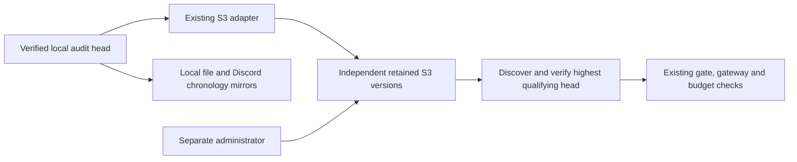

# W-25 / SEC-11: the smallest real independent witness

**Recommendation:** retain the existing AWS S3 Object Lock Compliance adapter, use one dedicated
private general-purpose bucket and one production audit prefix, and keep its administration outside
the Cockpit host and Discord bot. Tighten the proposed IAM list permission to the **exact prefix**
before provisioning. Prove the actual retained version and recovery behavior before activation.
There is no qualifying WORM witness configured today. Discord remains chronology/mirror evidence.

This is a research and activation plan, not an activation receipt or a replacement development
schedule. W-25 is implemented but activation-blocked; SEC-11 remains **OPEN, P0 pre-live**. The
provider/cost decision and real independent evidence remain necessary. This document does not
authorize cloud spending, a mode change, or paper opening orders.

## Evidence boundary and current observations

The inspected source is commit `892e2dbaab0093e91857cea373dc188d638d8d80`, on local branch
`work/astra-fresh-install-smokes-2026-09-06`. Research began at `2026-09-07 00:45:54 UTC`, which is
September 6 in Pacific time; the requested filename uses that Pacific date. This workspace is a
research environment, not an attestation of the operator's Windows installation or a deployed host.

Read-only checks in this workspace returned:

| Observation | Result | What it establishes |
|---|---|---|
| `witness_s3_access_key_id` under keyring service `ai-investment-cockpit` | absent | This process cannot obtain the dedicated runtime access key through the canonical lookup. |
| `witness_s3_secret_access_key` under that service | absent | The corresponding runtime secret is also unavailable. |
| Nonblank bucket, region, and expected-owner entries in `app/.env` | all absent | The checked file does not configure the required witness identity. This is not a dump of effective settings or the shell. |
| Nonblank prefix and minimum-retention overrides in `app/.env` | absent | Defaults exist in code; their omission alone is not a provisioning failure. |
| AWS API activation/deletion/retention calls | none performed | No real cloud acceptance or rejection is claimed. |

The credential probe printed names and presence verdicts only. It queried only the two witness
entries and wrote none. The [earlier operator evidence](w25-admin-discord-worm-witness-2026-08-17.md)
also records these two credentials missing, a mirror-only composed store, and no configured WORM
bucket. Today's user-supplied state agrees with that record. Presence of unrelated feed, Discord,
broker, or API credentials was not rechecked and cannot substitute for these credentials.

No production ledger was opened or rewritten, no soak was run or modified, no Discord API was
called, and no external witness record was created. Existing isolated test fixtures, when cited
below, are implementation checks only. They are not prospective observations or independent
retention evidence. Unrelated concurrent workspace evidence belongs to its respective work.

## What the witness must prove

The local audit HMAC and signed high-water reject ordinary truncation, sequence reuse, and many
domain-row mutations. A captured genuine old database **plus its genuine old watermark**, restored
into a new process, can still represent a valid historical chain. A same-host file or restored VM
cannot establish which history is current.

The added fact is an independently recoverable `(sequence, head_hash)` that remains outside that
rollback. The verifier must find the highest unambiguous qualifying external claim without relying
on a locally remembered object/version ID. The local chain must reach that sequence **and contain
the same hash at that sequence**. Merely comparing sequence numbers would miss a rewritten fork
that has caught up. This is the contract in
[AuditLog.verify_session_against_anchor](../../app/storage/audit.py#L409).



The runtime needs write/read access, not administration. AWS account administration, recovery
credentials and the approved bucket/prefix identity must remain recoverable outside the host's
snapshot and outside the bot/model. An existing AWS account can suffice if that separation is real;
a second account is not intrinsically required. A second process or WSL instance on the same
Windows host does not supply independent custody.

This mechanism proves a retained audit floor, not the truth of model analysis, completeness of a
cohort, profitability, or pre-outcome chronology for an artifact first uploaded later. Its payload
contains an audit hash and sequence, not a copy of the ledger or an evaluation dataset. Recoverable
ledger/raw-data backups remain a separate requirement.

## Smallest deployment and missing inputs

Use the [existing W-25 runbook](../runbooks/w25-worm-audit-witness.md), subject to the policy correction
and evidence gaps below. Preserve its seven-year bucket-default Compliance retention, one-year
application minimum, SSE-S3 encryption, Block Public Access, and Bucket owner enforced ownership.
Seven years is the project's selected configuration; this document makes no legal-retention claim.

| Input or principal | Required action / location | Current status |
|---|---|---|
| Provider, account, region, recurring-cost envelope and retention commitment | Operator records a concrete choice before funded provisioning. | Not supplied by this task; AWS is the recommended implemented route. |
| AWS provisioning administrator | Separate authenticated administrative session; review account recovery and effective IAM policies outside the Cockpit host. | No administrator access assumed or used. |
| Runtime access-key pair | Store only as `witness_s3_access_key_id` and `witness_s3_secret_access_key` in OS credential service `ai-investment-cockpit`. | Both absent in this workspace. |
| `COCKPIT_WITNESS_S3_BUCKET` | Dedicated nondotted bucket name, recorded outside the local restore domain as well as in non-secret config. | Unset in checked file; real bucket existence unverified. |
| `COCKPIT_WITNESS_S3_REGION` | Actual supported standard AWS region, matching the bucket. | Unset in checked file. |
| `COCKPIT_WITNESS_S3_EXPECTED_BUCKET_OWNER` | Exact 12-digit account identity, corroborated by the administrator. | Unset in checked file. |
| `COCKPIT_WITNESS_S3_PREFIX` | One fixed namespace per ledger; default `ai-investment-cockpit/v1`, yielding list prefix `ai-investment-cockpit/v1/audit-anchor/`. | Code default exists; no production namespace independently commissioned. |
| `COCKPIT_WITNESS_S3_MIN_RETENTION_DAYS` | Preserve default `365` for this plan. | Default exists. Settings permit other values; the adapter does not enforce the seven-year runbook policy itself. |
| Independent readback | Separate reader session/device with read-only access to the approved namespace. It must discover the head afresh. | Not performed; no extra runtime secret is needed for an operator-run readback. |
| OS credential backend | Windows Credential Manager, macOS Keychain, or Linux SecretService accessible to the actual runtime user. | The local presence check does not prove production backend readiness. Headless Linux needs provisioning; the test backend is not deployment evidence. |

The current factory takes an explicit two-part AWS keypair, regional HTTPS endpoint, TLS
verification, and SigV4. It does not accept a session-token argument or an assume-role/SSO setup.
Temporary AWS credentials require a session token; do not insert an incomplete
temporary credential into the two keyring slots. A change to credential delivery would be a
separate implementation package. Broker keys, the audit HMAC key, Discord tokens, AWS CLI profiles,
instance credentials, and another provider's application keys are not substitutes.
[AWS temporary-credential contract](https://docs.aws.amazon.com/IAM/latest/UserGuide/id_credentials_temp_use-resources.html).

Sources for these application contracts:
[composition](../../app/main.py#L78), [factory](../../app/bridge/witness.py#L514),
[settings](../../app/config/settings.py#L340), [credential wrapper](../../app/core/secrets.py),
and [canonical setup names](../setup/accounts-and-keys.md).

## Provisioning correction: pin the namespace in IAM

The runbook currently permits `s3:ListBucketVersions` using `StringLike` with
`ai-investment-cockpit/v1/audit-anchor/*`. The adapter accepts nested prefix strings and appends
`/audit-anchor/` to them. Thus a locally substituted prefix such as
`ai-investment-cockpit/v1/audit-anchor/alternate` produces a list request under the wildcard's
allowed descendants. Its object writes also fit the runbook's object-resource wildcard.

**Inference from source and policy semantics:** a new empty child namespace could be treated as
first activation and receive an older local head, leaving the original higher retained head outside
the query. Expected owner and Object Lock would still be correct. This is a namespace substitution
problem, not deletion of a protected S3 version. A local constructor/glob probe confirmed the
accepted nested path and wildcard match; no AWS IAM evaluation or cloud exploit was executed.

For the production runtime identity, replace that list condition with exact equality:

```json
{
  "StringEquals": {
    "s3:prefix": "ai-investment-cockpit/v1/audit-anchor/"
  }
}
```

Render it for the actual approved prefix, including the trailing slash. Keep the object resource
limited to that namespace and prevent other policies from broadening list access. An explicit
principal-scoped deny for a different or absent list prefix should be included in the reviewed
effective policy. Test both a sibling and a nested-prefix substitution with the real runtime
identity. Neither must become an empty, writable replacement authority.

AWS documents that `ListBucketVersions` supports `s3:prefix`; `StringEquals` is exact while
`StringLike` supports wildcard matching. This correction concerns the proposed policy, which has
not been installed. [S3 prefix policy contract](https://docs.aws.amazon.com/AmazonS3/latest/userguide/amazon-s3-policy-keys.html),
[IAM string conditions](https://docs.aws.amazon.com/IAM/latest/UserGuide/reference_policies_elements_condition_operators.html).

The runtime allow set remains small: bucket lock-configuration read; exact-prefix version listing;
and namespace-scoped `PutObject`, `GetObjectVersion`, `GetObjectRetention`. Retain the runbook's
denials of object/version deletion, retention and legal-hold mutation, bucket lock/versioning
mutation, and governance bypass. No IAM, account administration, or permission to change the
bucket policy belongs to the runtime. Independent test namespaces need their own scoped test
identity; do not give the production identity a collection of selectable fresh namespaces.

## Existing refusal paths, and where a green result is weaker

| Location | Existing behavior | Boundary / evidence needed |
|---|---|---|
| [main._build_anchor_store](../../app/main.py#L78) | Missing/blank/partial required WORM inputs add no S3 adapter. The store remains non-`None`, with mirrors only; partial setup logs missing field names. | `has_out_of_domain_witness=True` means an adapter was constructed, not that a retained head was proven. Factory/configuration errors may refuse composition rather than produce a healthy degraded startup. |
| [GitAuditLogAnchorStore.latest](../../app/bridge/anchor.py#L201) | Ignores the local Git/file adapter and rolling Discord adapter. With no readable S3 authority it returns `None`. | Production constructs one S3 authority. Do not add a second backend as a fallback: the generic store selects among readable adapters and does not prove multi-provider consensus or complete availability. |
| [S3ObjectLockWitness.read_latest](../../app/bridge/witness.py#L463) | Returns `None` on strict-proof errors. Rejects unreadable/wrong bucket lock config, malformed identities, insufficient/non-Compliance retention, body/key/metadata/checksum mismatch, candidate markers or duplicate versions, and incomplete highest-group proof. | Empty and failed reads share the public `None` result. Diagnostics need real sanitized API results; an empty display cannot identify the cause. |
| [S3ObjectLockWitness.publish](../../app/bridge/witness.py#L469) | Strict pre-read, monotonic guard, conditional PUT, non-null version ID, then exact-version current-head proof. Rewind/fork, bad retention, unreadable proof, or a concurrent competing head refuses publication. | A timeout or failed post-read can occur after S3 persisted the object. Inspect the existing version; do not infer that nothing was written or change prefix to obtain success. |
| [compute_gate](../../app/orchestrator/gate.py#L103) | Auto-mode gate refuses absent store, absent anchor, or chain/anchor mismatch; `anchor_ok=False`. | This function evaluates auto rungs, not every paper/read-only status. It is not authorization for a Codex auto decision job. |
| [ModeLadder.current](../../app/orchestrator/mode_ladder.py#L187) | For an otherwise valid active auto rung with a wired store, absent/mismatched anchor returns `read_only`. | Other rungs have different logic; an expired auto arm is handled earlier. Do not claim every mode read necessarily performs a witness consult. |
| [OrderGateway._pending_ok](../../app/brokers/gateway.py#L552) | With a wired store, absent/mismatched anchor returns a failed exposure check. Review/submit callers refuse. | Some unit fixtures intentionally omit a store; production composition must retain the non-`None` store. Do not remove it to bypass the refusal. |
| [DeepBudget chain guard](../../app/workflows/budget.py#L76) | With a wired store, absent/mismatched anchor raises `BudgetIntegrityError`; it cannot supply trusted budget usage. | A unit fixture with no store exercises a different contract. |
| [Paper-performance reconstruction](../../app/brokers/paper_performance.py#L124) | A returned anchor is checked in the same ledger snapshot. If `latest()` returns `None`, it uses local `verify_session` instead. | **Not an independent-witness outage refusal.** A locally valid performance result must not certify W-25. |
| [Restart usage restoration](../../app/orchestrator/state.py#L58) | Checks a returned anchor; verification failure installs the exhausted sentinel. A missing returned anchor falls back to local verification. | **Not an independent-witness outage refusal.** Review this fallback before claiming that external-read failure alone causes restart-wide `watch_only`. Existing gateway/budget/auto barriers remain separate. |
| [run_anchor_head](../../app/orchestrator/scheduler.py#L125) | Skips no-store/unverified-chain/no-head cases; otherwise calls `append` and reports `anchored_seq`. | Mirror-only append can succeed and produce that report. It does not prove S3 publication or readback. |
| [DiscordSemanticWitness](../../app/bridge/witness.py#L567) | W-24 exact-message verifier binds ID/content/channel/authenticated bot author, null edit state, and server time; edits, deletion and read failure refuse. | Its separate `out_of_domain=True` flag is chronology-scoped. It is not a rolling audit adapter and is not installed as SEC-11 authority. Never promote it by reusing the flag. |

The performance/restart fallbacks are source findings, not a newly demonstrated order bypass.
They invalidate blanket claims that every witness consumer refuses identically. Decide whether
those two paths should explicitly distinguish never-configured from configured-but-unavailable
before asserting wider runtime protection. Any repair needs its own bounded package and tests;
this research does not change their behavior.

## What AWS protects, and what remains an operational assumption

Object Lock Compliance protects individual retained versions; a writer may still create new
versions and a sufficiently privileged principal may create delete markers. Retention on the
original version survives those operations. Compliance retention cannot be shortened or the
retained version deleted even by account root; AWS documents account deletion as an exception.
Governance and removable legal holds alone do not meet the selected contract.
[AWS Object Lock](https://docs.aws.amazon.com/AmazonS3/latest/userguide/object-lock.html).

The adapter's reverse-sequence schema-v2 keys make higher sequences sort first. One version-list
page, capped at 128 entries, must prove the complete highest sequence group. Exactly one candidate
version and no candidate delete marker are accepted. A truncated page that never reaches a lower
sequence refuses; the reader does not skip an invalid higher claim to trust a lower one. Lower
history is not fully re-audited on every consult. This is a bounded recovery proof, not a mutable
`latest.json` pointer. [Implementation](../../app/bridge/witness.py#L215),
[S3 object-key ordering](https://docs.aws.amazon.com/AmazonS3/latest/userguide/object-keys.html#object-key-sort-order),
[version-list pagination](https://docs.aws.amazon.com/AmazonS3/latest/userguide/list-obj-version-enabled-bucket.html).

Distinct object operations are not a multi-object transaction. A post-write proof establishes
what was observed at that read; a later writer can still cause a later refusal. The runtime's
write credential can poison a namespace with a higher or conflicting claim and cause denial of
service. WORM does not prove that a claim is true. Local HMAC membership verification prevents an
unrelated claim from authorizing the ledger. [S3 consistency boundaries](https://docs.aws.amazon.com/AmazonS3/latest/userguide/Welcome.html#ConsistencyModel).

Keep the approved identity and effective IAM policy independently recoverable. An administrator
can disrupt access or future defaults even though prior retained versions survive. Avoid archival
transitions that require restore before a trust read. SSE-S3 avoids a customer-managed KMS key
whose deletion could make intact retained evidence unreadable. These are availability and recovery
requirements, not reasons to accept a mirror during outage.
[Object Lock considerations](https://docs.aws.amazon.com/AmazonS3/latest/userguide/object-lock-managing.html).

The present anchor has no freshness timestamp or maximum-age gate. The scheduler runs every
30 minutes **on weekdays in America/New_York**, including outside market hours. A successful
publication only protects the prefix of the ledger through that head. It does not attest events
after that point, and weekends, downtime, or repeated publication failures can make the interval
much longer than 30 minutes. Remaining retention is not freshness. Commissioning must state this
residual window and measure publication health; this plan does not rewrite the scheduler or soak
to claim synchronous protection of every event.

## Cost and compatibility checks before an irreversible write

BUG-110 already removed history-dependent request growth. For a nonempty, unambiguous namespace:

| Operation | Application-level S3 calls, without SDK retries |
|---|---:|
| One strict trust read | 1 lock-config GET + 1 version LIST + 1 exact-version GET + 1 retention GET = 4 |
| One new append through the production store | 3 complete proofs + 1 PUT = 13 |
| One idempotent store append of the same head | 2 proofs, no PUT = 8 |

If `R` is other trust reads, `P` is new appends, and `I` is unchanged-head append attempts, the
ordinary successful workload is `4R + 13P + 8I` calls. Split by request category when pricing;
LIST is not a cheap object GET. Empty-prefix commissioning has fewer candidate reads; failed
requests, operator inventory and independent readbacks add work. Use actual regional prices and
the measured workload, not object size as a cost proxy.
[AWS S3 pricing](https://aws.amazon.com/s3/pricing/).

There are 48 scheduled attempts per full weekday, approximately 1,040 per average month assuming
260 weekdays per year. If each creates a distinct anchor, publication alone contributes about
13,520 logical calls per average month. Canonical payloads are 129–148 bytes, depending on sequence
width; 87,360 maximal-width payloads over seven such years total about 12.3 MiB before metadata,
drills and storage accounting. These are arithmetic scenarios, not measured traffic or a bill.

The factory uses `Config(retries={"mode": "standard", "max_attempts": 3})`. In a Config object,
that permits three retries **in addition to** the initial request. The four/thirteen counts are
SDK method counts, not guaranteed HTTP-attempt counts. No explicit connect/read timeout or total
operation deadline is set; the installed botocore defaults are 60 seconds each. A bounded number
of calls does not establish acceptable control-loop latency. Record successful and failed-read
latency before runtime attachment; if it misses the chosen budget, claim a small adapter timeout
repair and adversarially review it. [Boto3 retry semantics](https://docs.aws.amazon.com/boto3/latest/guide/retries.html),
[botocore timeouts](https://docs.aws.amazon.com/botocore/latest/reference/config.html).

Also verify the first PUT against the real locked bucket using the actual deployed SDK version.
The adapter passes `ChecksumSHA256`, `IfNoneMatch="*"`, and relies on bucket-default retention;
it does not explicitly pass `ChecksumAlgorithm` or `ContentMD5`. AWS's upload documentation calls
for `Content-MD5` or `x-amz-sdk-checksum-algorithm` for Object Lock uploads. Existing FakeS3 tests do
not establish that actual wire request's acceptance. This is a compatibility check to resolve,
not a claimed live failure; preserve the SHA-256 readback requirement if a small upload-header
repair proves necessary. [PutObject contract](https://docs.aws.amazon.com/AmazonS3/latest/API/API_PutObject.html).

An operator spending threshold/alert is not a hard billing cap. Price request volume, retained
storage, independent reads, chosen monitoring, transfer, and taxes. Stop future writes if a
budget is exceeded, preserving fail-closed gates and already retained evidence. Do not shorten
retention, lower cadence, or switch to a local cache to manufacture a low-cost PASS.

## Phased plan and exit evidence

| Phase | Work | Exit evidence and resulting status |
|---|---|---|
| 0 — Research and honest status | Keep current runtime authority unchanged. Preserve this map, existing evidence and all refusals. | This document; status remains **unconfigured / SEC-11 open**. |
| 1 — Concrete provisioning review | Record account, region, actual bucket/prefix, retention, cost envelope, separate administrator, exact-prefix policy, recovery identity and latency budget. Resolve source findings that affect the promised activation contract. | Reviewable resource/policy packet and operator funded-resource authorization. No AWS write is implied by this research request. |
| 2 — Independent storage commissioning | Provision the selected real bucket. Review versioning/lock defaults/encryption/public-access/ownership and effective runtime policy. Use isolated drill prefixes with test-scoped identities; production prefix remains empty. | Actual API/configuration evidence and an independently readable retained diagnostic version. Status is **storage commissioned; production witness not active**. |
| 3 — Adversarial acceptance | Run the cases below with an isolated ledger and real S3. Use the existing adapter/store without attaching Discord mirrors or starting a soak. Separate diagnostic claims from production audit history. | Sanitized requests/results, retained-version identity, independent recovery and composed consumer refusals; independent adversarial review. Failures remain recorded and block promotion. |
| 4 — Production attachment | After review and explicit activation authorization, verify the production ledger, keep `read_only`, use the single approved empty production prefix, and publish its actual verified head. Never seed it with a drill or old arbitrary sequence. | Exact version/retention readback, fresh external highest-head discovery and matching local hash membership. W-25 activation may be assessed; other trading/evidence gates remain separate. |
| 5 — Operation and recovery | Observe existing publication cadence, failed reads, credential rotation, latency and costs. Independently recover the pinned identity and reread the latest head after local state loss. | Dated actual health/recovery evidence. Outages or ambiguity refuse authority; repairing availability does not reclassify prior missing observations. |

Phase 3 is a finite drill, not a rewrite of the ongoing soak. A diagnostic ledger must be real
and explicitly identified as diagnostic, with its own namespace. Never mix manufactured attack
records into the production namespace or present them as real investing activity. In phase 4,
attaching the full mirror-enabled store can post to Discord; use an expressly authorized
adapter-only publication path if Discord posts remain prohibited. This task performs neither.

The current runbook still contains an old hosted/macOS matrix requirement. Current **DEC-09** in
[PLAN](../PLAN.md) and [REGISTER](../REGISTER.md) governs: native Windows and Ubuntu/WSL2, each on
Python 3.11 and 3.12, locally on the operator workstation. Hosted Actions and macOS are not current
release gates. The recorded local matrix does not supply independent cloud evidence. A future
code repair still needs the required matrix and any applicable adversarial review.

## Real-cloud drill: expected results, not fabricated receipts

| Case | Required observation |
|---|---|
| Fresh publish/readback | Retain exact canonical bytes, key, payload digest, returned non-null version ID, AWS timestamps/request IDs, bucket default and exact-version `COMPLIANCE` retention. Independent reader rediscovers the same head without the writer's cache. |
| Runtime privilege limits | Runtime deletion, version deletion, retention shortening, legal-hold and bucket-configuration mutation are denied. Read/list/put work only for the approved resources and exact list namespace. |
| Actual retention enforcement | A separate authorized drill principal whose policy otherwise permits version deletion/retention changes still cannot delete the retained Compliance version or shorten its retention. A runtime IAM denial alone does not prove WORM enforcement. |
| New version / simple delete | With appropriate drill permission, these may succeed by creating a version or marker. The original retained version remains; a candidate duplicate or marker yields no trusted head. Do not call an allowed marker a failed Object Lock guarantee. |
| Same-sequence fork or duplicate | The reader refuses, including byte-identical duplicate versions; neither the latest-object view nor a lower anchor is accepted as a fallback. |
| Higher conflicting claim / incomplete candidate group | The claimed highest group either verifies completely or produces no anchor, including overfull/truncated groups. Inventory retained artifacts separately. |
| Wrong bucket owner / sibling or nested prefix | The runtime cannot redirect discovery or bootstrap a substitute authority. An absent trusted read keeps dependent checks closed. |
| Captured-watermark rollback | After recording genuine diagnostic heads N and M, M > N, restore the diagnostic DB and signed watermark to N in a **new process**. Local verification can pass; external verification must reject against M. Check hash membership as well as sequence. |
| Total local loss | A separate process/device with approved read access and independently retained namespace identity discovers M without a local pointer or old receipt. A clean process on the same machine proves cache independence only; separate custody supplies the external evidence. |
| Retention/identity/body faults | Short/Governance/malformed/unreadable candidate evidence refuses. Use separately declared diagnostic objects; do not shorten an existing Compliance record to stage a test. |
| Outage / credential revocation / denied list or retention read | Strict adapter read returns no anchor; gateway, deep-budget and auto consults refuse. Record performance/restart fallback behavior explicitly; do not label it a blanket `watch_only` result. |
| PUT response lost / post-write race | Determine whether a real version exists through fresh readback. A failed method return is not proof of no write. Retry only against the same independently pinned namespace after examining the retained state. |

The diagnostic test principal is distinct from production. Conflicting retained versions can
leave a drill prefix unusable for years; plan the finite object inventory and retention cost
before writing. Preserve failed cases. Do not delete evidence, reset a namespace, lower a head,
or backdate a receipt to make the drill pass. Do not mutate the production database for rollback
testing. No live/auto rung or broker credential is needed to demonstrate a refusal.

Evidence should identify code/SDK versions, the test-ledger scope, independently held bucket and
policy identities, UTC observation time, exact key/version/hash, retention deadline, sanitized
API request IDs/statuses, resulting consumer decisions and the observing operator. Credential
values, authorization headers, session tokens, presigned URLs and raw SDK debug logs do not
belong in the evidence. Local Markdown is a review record; independent readback of retained
provider state is the witness proof.

## Alternatives and what is possible without WORM credentials

| Candidate | Disposition |
|---|---|
| AWS S3 Compliance | Smallest implementation change because the provider is already implemented. Provisioning, exact-prefix policy review and real evidence are still missing. |
| Discord, local Git/file, same-host service/VM, same-rollback-domain VPS storage | Useful chronology or copies, not the independent monotonic fact. More copies inside one privileged restore boundary do not change that boundary. |
| Cloudflare R2 Bucket Locks | Not a drop-in for this adapter. Cloudflare documents removable bucket-lock rules and marks required S3 lock configuration/expected-owner features unsupported. Keep it outside SEC-11 authority. [R2 locks](https://developers.cloudflare.com/r2/buckets/bucket-locks/), [compatibility](https://developers.cloudflare.com/r2/api/s3/api/). |
| Backblaze B2 Compliance Object Lock | A real provider retention capability, not inherently fake WORM. Its documentation describes non-removable Compliance retention; that does **not** establish compatibility with this AWS-pinned adapter. A provider-specific reviewed implementation and full identity/checksum/listing/retention/recovery evidence would be new scope. No price or drop-in eligibility is asserted. [B2 Object Lock](https://www.backblaze.com/docs/cloud-storage-object-lock), [B2 S3 surface](https://www.backblaze.com/docs/cloud-storage-s3-compatible-api). |
| Sigstore Rekor | Research only. Inclusion and consistency proofs are promising; an inclusion receipt for one old checkpoint does not prove that no later checkpoint exists. Service-policy fit, privacy, pinned identity, complete highest-head discovery after local loss, quotas and availability need a separate design. [Rekor](https://docs.sigstore.dev/logging/overview/). |
| Independently administered human/device custody | Can preserve an independently held copy or observation. A manual receipt can attest what that observer actually saw at that time. Automatic monotonic discovery, protected administration/storage and fail-closed integration are not implemented; do not set `out_of_domain=True` for an ordinary file or signature. |

While WORM credentials remain absent, preserve completed evidence bytes and honest chronology.
An independently held copy, if later expressly authorized, can improve custody without claiming
runtime SEC-11 authority. Uploading an old soak artifact now proves retention/observation from now;
it does not retroactively witness its claimed creation time, repair missing samples, or turn a
historical run into a prospective one. Leave the soak and its labels unchanged.

## Validation and open decisions

Source inspection covered composition, credentials/settings, both Discord roles, the bounded S3
reader/writer, the anchor store, all mapped consumers, the scheduler, canonical security/plan
records and existing regressions. Official provider/SDK documents were checked during this
research. The local namespace probe created no witness records and made no AWS requests.

Focused regression result: **176 passed, 1 deselected in 4.07 seconds** across witness adapters,
anchor stores, SEC-11 orchestration, scheduler, monotonic sequences, domain-row/budget binding,
composition and environment-secret guards. The initial 177-test selection stalled and was
interrupted; the unrelated HTTP TestClient test
`test_brief_endpoints_answer_through_services_and_proposals_read_rows` was excluded from the
successful rerun. Its completion is not claimed. Ruff passes; all 23 local link targets exist,
the policy JSON parses, and the document has no trailing whitespace or unbalanced fences.
An isolated rerun of that single test also exceeded a 15-second process limit (exit 124);
the five-second stack dump showed its first `client.get` at test line 305 waiting through
Starlette TestClient / AnyIO's thread portal. That identifies the stalled surface, not its root
cause. No HTTP-test repair or broader full-suite PASS is claimed.

The environment is the project `.venv`, Linux Python **3.13.5**, boto3/botocore **1.43.89**. These
results are supplemental implementation evidence, not one of the required DEC-09 platform cells,
not a fresh independent review, and not real S3 evidence. Tests used an in-memory keyring and a
nonexistent environment-file path, with ambient `COCKPIT_*` variables cleared inside their child
process. No production code or tests were changed for this document.

The next review packet must resolve the concrete funded provider/account choice, exact-prefix
policy, external administrative custody, credential lifecycle, upload compatibility and latency,
the stated missing-anchor fallback scope, and the residual publication window. Then perform the
real independent drill. Until then, **W-25 activation remains blocked and SEC-11 remains open**.
