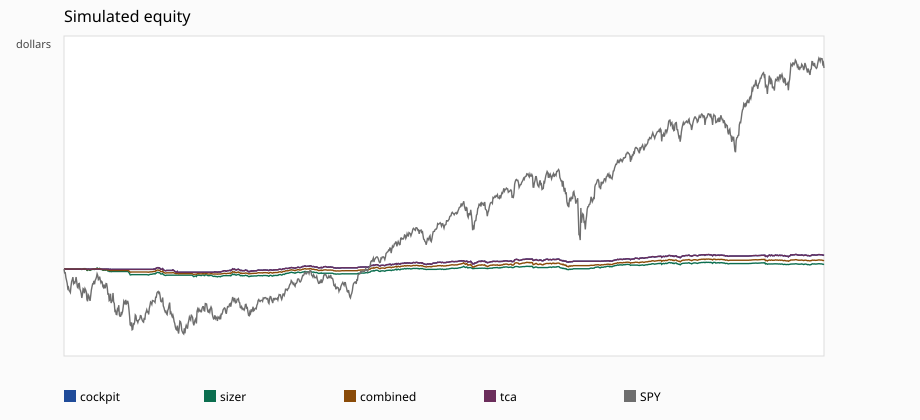
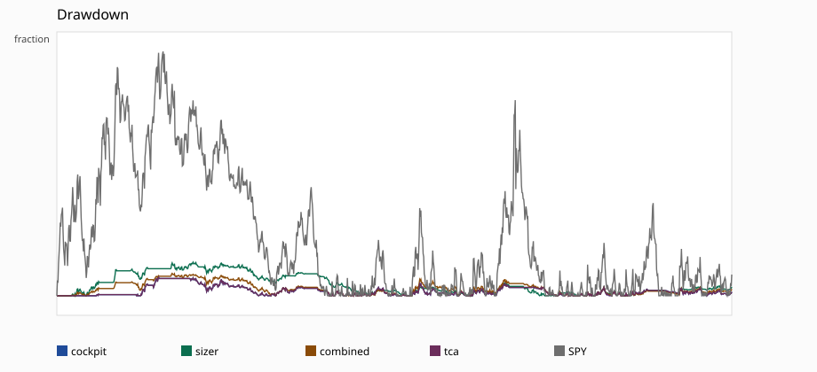

# Combined historical replay

SPY annualized Sharpe on the same sessions is 0.752656051671. The highest variant is tca at 0.703102. Variants above SPY on that display Sharpe: none. Cockpit excess Sharpe versus SPY is -0.730066774903 (beta 0.0520574190387). Sizer ends at 25400.99808829251353330590977 and the combined sleeves end at 25743.67624026100456216136228, both below the cockpit stand-in at 26223.68420694447515292595555. TCA ends 3.80393424391491548868481 dollars away from that stand-in.

This is a simulation under shipped dollar limits. It is not a qualify decision, and it is not evidence the live cockpit would have traded these names.

## What ran

- Decision source: `combined.deterministic_stand_in.v1`. A 60-session trailing-return sign, long only, sized at the shipped $1,000 max notional. No thesis text was generated.
- Approval stand-in: `paper_approved_risk_only.v1`. A paper-mode order is queued only when `risk.engine.evaluate` returns `approved`. There is no historical click log to replay.
- Fill: next adjusted open, and only when that price is still inside the prior-close limit. Flat variants pay 1 bp. The TCA variant pays a predeclared half-spread of 0.5 bp plus `0.10 * sigma * sqrt(qty / ADV)`.
- Universe: SPY, QQQ, IWM. Starting equity $25000. Rebalance every 5 sessions after 60 closes.
- Scored sessions: 1194. DSR and PBO use n_trials=4 (cockpit, sizer, combined, tca).
- `orders_submitted` is 0. The simulated book is local.

## What did not run

- Composed production posture (`require_quant_verdict` and `require_net_edge`, no book and no edge estimate) returned `needs_human` with warnings ['execution_quality', 'net_edge_available']. Simulated fills under that probe: 0. Live drafting wires those flags whenever a book or metrics function is attached, so this daily tape would not mint an order.
- No `llm_audit` judgment log and no stored TradeProposal tape exist in the tree. The model was not called. Outputs were not invented.
- Kronos weights are not in the tree. The combined sleeve marks the committed `examples/kronos_eval.json` equity curve on and after its first point (2024-07-02), scaled to a $1,250 sleeve. That curve is a recorded walk-forward book, not a new forecast, and it is not turned into per-symbol proposals.
- Options VRP is the existing Black-Scholes stand-in on adjusted closes (`options_days_applied`=943), scaled to a $1,250 sleeve. `risk.engine` admits `equity` only, so the sleeve never becomes an order. Adjusted closes are not historical option spots.
- `sidecar.merger` scores cash-deal completion from EDGAR observations. This tape has no deal observations, so that model contributes no weight.
- Quant momentum, pairs, and the market maker need a limit-order book. This tree has no historical book, so those strategies are not stepped.
- The order gateway's SQL audit chain, HMAC approval, halt file, and calendar coverage are not instantiated. The simulated path is risk, then paper mode, then the approval stand-in, then a local fill.

## Results

| variant | ending equity | CAGR | ann. Sharpe | PSR | DSR | max DD | fills | limits expired |
| --- | --- | --- | --- | --- | --- | --- | --- | --- |
| cockpit | 26223.68420694447515292595555 | 0.0101367635984 | 0.701078048326 | 0.934760131362 | 0.67727417843 | 0.0177609451387 | 245 | 265 |
| sizer | 25400.99808829251353330590977 | 0.0033640932112 | 0.236797388532 | 0.696083233018 | 0.294959148555 | 0.0321808999912 | 267 | 276 |
| combined | 25743.67624026100456216136228 | 0.00620588041968 | 0.42122823132 | 0.817836919751 | 0.442367149527 | 0.0214624260203 | 297 | 312 |
| tca | 26227.48814118839006841464036 | 0.0101676872546 | 0.703102060735 | 0.935309891517 | 0.678829308918 | 0.0177493164487 | 242 | 269 |
| SPY | 43161.09124724499488859015945 | 0.122153496398 | 0.752656051671 | 0.95011173114 | 0.95011173114 | 0.234239754703 |  |  |

PBO on the four aligned variants: status=ok, pbo=0.013986013986, splits=6435. PBO ranks those four books against each other. Cockpit and TCA are almost the same path, so a low PBO does not mean either one beat SPY.

SPY's DSR uses n_trials=1 because it is the benchmark path, not one of the four searched variants.

## By regime

Regime uses SPY data through the prior close. Bull means the trailing 60-session SPY return is positive. High vol means the trailing 20-session standard deviation exceeds the trailing 252-session standard deviation. Unclassified is the stretch before that 252-session baseline exists.

- cockpit: bull n=870 sharpe=0.951475399249; bear n=324 sharpe=-0.435753887974; high_vol n=288 sharpe=1.05264175675; low_vol n=714 sharpe=0.977326438322; unclassified n=192 sharpe=-1.30289404999
- sizer: bull n=870 sharpe=0.498910662364; bear n=324 sharpe=-0.414405140313; high_vol n=288 sharpe=0.626637749175; low_vol n=714 sharpe=0.721100091613; unclassified n=192 sharpe=-1.6347528314
- combined: bull n=870 sharpe=0.704706131523; bear n=324 sharpe=-0.629567871598; high_vol n=288 sharpe=0.509039550983; low_vol n=714 sharpe=0.868463494826; unclassified n=192 sharpe=-1.76786236958
- tca: bull n=870 sharpe=0.953447119213; bear n=324 sharpe=-0.433164162252; high_vol n=288 sharpe=1.05402025356; low_vol n=714 sharpe=0.97940249007; unclassified n=192 sharpe=-1.29936400347

## Costs and the sizer

The shipped cap is $1,000 on a $25,000 book. Daily ETF volatility is near the sizer's 1% target, so the vol budget wants more than $1,000 and the cap binds. The sizer changes the book when the 20-session mean return and the 60-session trend disagree, because a non-positive edge sizes to zero.

Median implementation shortfall versus the decision close is -30.47803786606966086120898667 bp on the cockpit book. Buys fill only when the next open is at or below that close, so the delay versus the decision price is favorable by construction. It is the limit filter, not a measured saving. Flat fills have no gap between arrival and the fill price. TCA impact fit status=fit, recommended=None, n_fills=242. The schedule used to worsen TCA fills was declared ahead of the run. A null recommendation means those fills did not identify a usable impact coefficient.

## Lookahead

- Equity signals and ADV use closes and volume through the decision session only. The fill is the next session's adjusted open.
- The options and Kronos sleeves add that session's already-recorded mark to cash. They do not change the equity target decided from the price window.
- Yahoo bars are backward-adjusted as of the fixture download. A split or dividend after a historical session is in the earlier prices. That is a point-in-time leak in the tape itself.
- An LLM call on these dates would be a second leak. None was made.
- The Kronos sleeve starts flat and steps to the recorded curve on 2024-07-02. Pre-cutoff Kronos forecasts are not used.

## Charts

Thresholds in the eval report are `not_frozen`. Nothing here is a pass, a live-capital permission, or a claim that the combination improves the cockpit.
